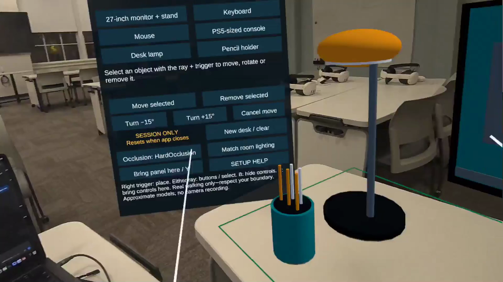
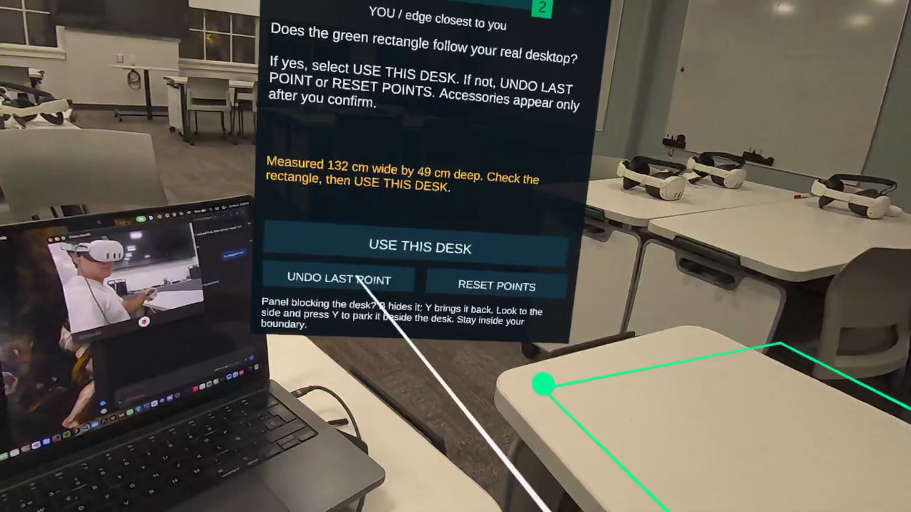

# DeskSpace

A **mixed-reality desk layout planner for Meta Quest 3**, built with Unity, C#, AR Foundation and OpenXR. Arrange approximately life-size equipment on your actual desktop before moving the real objects.

[Watch the walkthrough](https://youtu.be/gaZnIir4G_Y) · [Download the Quest APK](https://github.com/daniel-aguilar03/deskspace-mr-planner/releases/latest) · [Build from source](BUILDING.md)



## Highlights

- Guided, three-point desktop measurement using live depth hits.
- A real spatial anchor keeps the layout aligned while you move your head.
- Six stylized accessories: monitor with stand, keyboard, mouse, PS5-sized console, lamp and pencil holder.
- Move, rotate, remove and cancel edits, with up to eight placed items.
- Green/red placement feedback for desk edges and virtual-object overlaps.
- Off, hard and soft depth occlusion, manual lighting presets and desk-aligned shadows.

## Install on Quest

Download `DeskSpace-v0.1.2.apk` from [Releases](https://github.com/daniel-aguilar03/deskspace-mr-planner/releases/latest), then install it with Meta Quest Developer Hub, SideQuest, or an authorized ADB connection:

```sh
adb install -r DeskSpace-v0.1.2.apk
adb shell am start -n com.danielaguilar.deskspace/com.unity3d.player.UnityPlayerActivity
```

Developer Mode and USB debugging must be permitted on the headset. Open **Apps → Unknown Sources**, use both controllers and allow **spatial data**. Use a clear, well-lit desk and a safe boundary. The app does not request microphone or raw headset-camera image access.

**Session only:** the arrangement lasts while the app is running. Closing or restarting it begins a fresh setup; there is no Save/Load feature.

## Set up your real desk

1. Select **BEGIN SETUP** and face the desk from the side where you normally work.
2. Use the **right controller ray + index trigger** to mark the tabletop just inside the **near-left corner**, **near-right corner**, then **far edge**. Trigger when the candidate dot is green. Undo/reset lets you correct unfinished measurement.
3. Check the outline against the actual desk, then select **USE THIS DESK** to create the live anchor.
4. Choose an accessory, aim at a green position and trigger to place it. Red means its virtual footprint overlaps another item or extends beyond the measured desk.
5. Select an existing item to move, turn or remove it. **Cancel move** restores its previous position.

| Control | Action |
| --- | --- |
| Right ray + index trigger | Mark setup points and place accessories |
| Either ray + trigger | Operate buttons and select items |
| B | Hide/show the controls |
| Y / Bring panel here | Bring controls into view without moving the desk |
| SETUP HELP | Reopen directions without clearing the layout |
| New desk / clear, twice within three seconds | Clear this session and start again |

Look beside the desk before pressing Y to park the panel out of the way. Walk only within your safe real-world boundary.

## How it works

Three tabletop measurements define a rectangular surface. A real AR Foundation spatial anchor provides its reference frame, and accessory positions are stored relative to that anchor rather than the camera.

Placement checks use rotated 2D footprints: an accessory must stay within the desk and avoid other virtual accessories. Depth occlusion lets a real hand or object appear in front of virtual equipment. A transparent shadow receiver sits on the measured desktop, while manual lighting presets help the models fit the room.



## Development and scope

The Editor preparation tool runs **26 geometry/setup/session-only checks**. Guided setup followed real-headset usability feedback; the existing **0.1.2** build was tested on Quest 3, including basic real-desk alignment while moving the head. This export does not claim a new headset test or measured drift/performance certification. [Build and validation notes](BUILDING.md).

This is a layout preview, not certified CAD or an automatic room scanner. It assumes an approximately rectangular, clear desktop; it does not detect real clutter or reserve space for cables and ventilation. Models and depth edges are approximate, lighting is manual, and live alignment should be checked after tracking interruptions.

Persistent saving was deliberately removed after the Quest rejected it with a package-trust error. The feature is not presented as repaired: **live session anchors remain, cross-launch persistence does not**.

Created by **Daniel Aguilar**. See [credits, source foundations and licenses](CREDITS.md).
